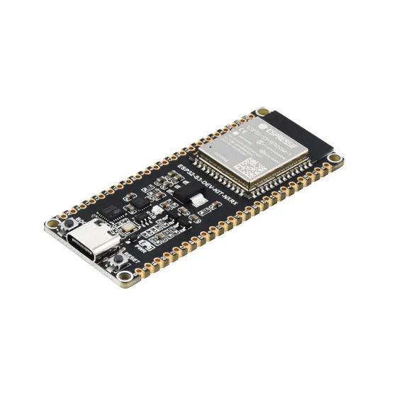
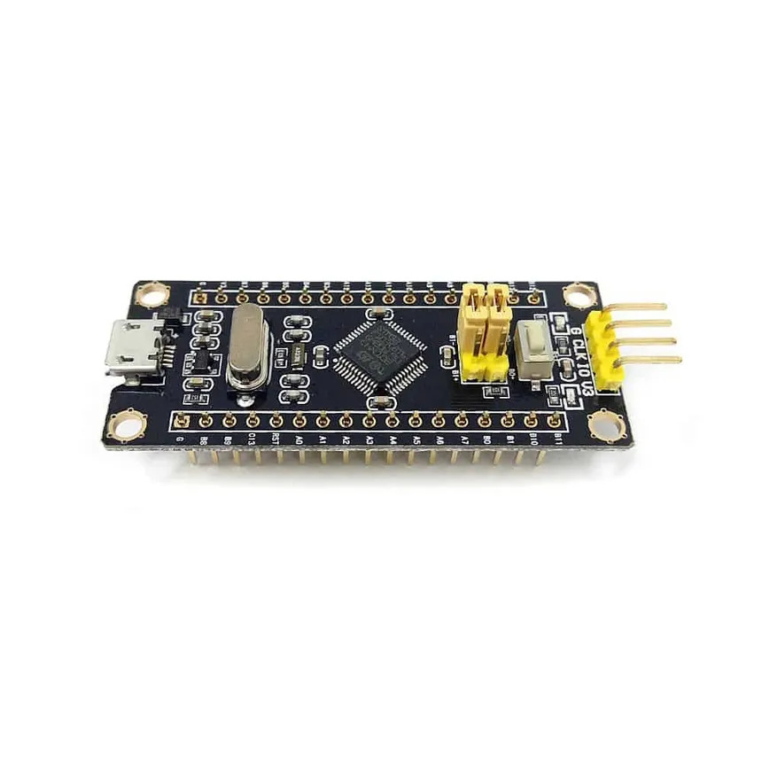
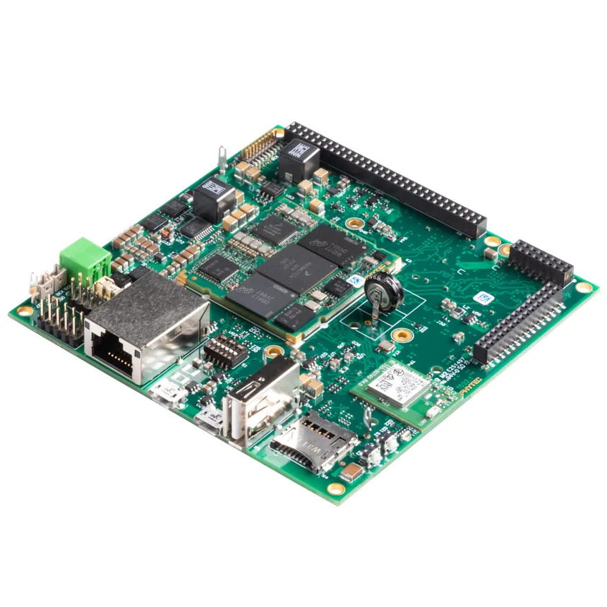

# freertos-multi-mcu

One FreeRTOS application running on three MCU families. The application logic lives in `projects/common` and calls only the FreeRTOS API. Each platform adds a thin board laye `bsp.h`, so porting means rewriting about 40 lines, not the application.

The application shows queues producer/consumer, event groups, a mutex with priority inheritance, counting and binary semaphores, software timers, task notifications and stack/heap diagnostics. The alarm logic is a state machine from [embedkit](embedkit), own hardware-independent C library.

| Platform | MCU | Toolchain |
|---|---|---|
| `projects/esp32` | ESP32 | PlatformIO + ESP-IDF |
| `projects/stm32` | STM32F411CCU7 | CMake + arm-none-eabi-gcc, CMSIS registers (no HAL) |
| `projects/nxp` | NXP i.MX 8M Mini EVK, Cortex-M4 core | MCUXpresso SDK (west) |

## Layout

```
embedkit/            git submodule, pure C, no hardware or RTOS dependencies
third_party/         git submodules for the STM32 build: FreeRTOS-Kernel, CMSIS_6, cmsis_device_f4
projects/
  common/            app_pipeline, app_primitives, rtos.h, bsp.h
  esp32/  stm32/  nxp/   board layer & build files per platform
docs/images/         photos and screenshots used below
```

## How it works

```
sensor_task --queue--> process_task --event bit--> alarm_task --> LED
     |                      |                           |
     +------- app_log() ----+---------------------------+
                  |
             log queue --> logger_task
button ISR --binary semaphore--> button_task
timer --notification--> stats_task 
```

## Pins

| Function | ESP32 | STM32F411 (Black Pill) | i.MX 8M Mini EVK (M4) |
|---|---|---|---|
| LED | GPIO2 | PC13 (on-board, active low) | GPIO5_IO11, header J1003-19, external LED |
| Button (falling edge, pull-up) | GPIO0 (BOOT) | PA0 (on-board KEY) | GPIO5_IO10, external button, check the J1003 pin in the schematic |
| Console TX | UART0 (USB) | PA2 (USART2), 115200 | UART4 (debug USB), 115200 |
| Sensor | simulated | ADC1 channel 1, PA1 | simulated |

## Just remember...  

`git submodule update --init`  

## ESP32

Requirements: PlatformIO, ESP32 dev board with USB.

```bash
cd projects/esp32
pio run                      # build
pio run -t upload            # flash over USB
pio device monitor -b 115200 # serial console
```

output:  

```
app_start: pipeline up
t=1000 raw=1240 avg=1180
--- stats: counter=214, free heap=... B ---
```

The BOOT button triggers the ISR-to-task path and prints `button: press #n`.



## STM32

Requirements: arm-none-eabi-gcc, CMake 3.20+, Ninja, ST-Link, and the `third_party` submodules:

```bash
git submodule add https://github.com/FreeRTOS/FreeRTOS-Kernel.git third_party/FreeRTOS-Kernel
git submodule add https://github.com/ARM-software/CMSIS_6.git third_party/CMSIS_6
git submodule add https://github.com/STMicroelectronics/cmsis_device_f4.git third_party/cmsis_device_f4
```

No HAL, the board layer uses CMSIS register access. FreeRTOS options are in `projects/stm32/Inc/FreeRTOSConfig.h` (100 MHz, heap_4, 48 KB heap, ARM_CM4F port, max syscall interrupt priority 5). To use checkouts from elsewhere pass `-DFREERTOS_KERNEL_DIR=... -DCMSIS_CORE_DIR=... -DCMSIS_DEVICE_DIR=...` to the configure step.

Wiring: ST-Link SWD to the Black Pill, USB-UART adapter RX on PA2 and GND, 115200 8N1, optional potentiometer on PA1.

```bash
cd projects/stm32
cmake --preset Debug
cmake --build --preset Debug
```

Flash with STM32CubeProgrammer CLI:

```bash
STM32_Programmer_CLI -c port=SWD -w build/Debug/stm32.elf -v -rst
```

or with OpenOCD:

```bash
openocd -f interface/stlink.cfg -f target/stm32f4x.cfg \
        -c "program build/Debug/stm32.elf verify reset exit"
```



## NXP i.MX 8M Mini

FreeRTOS runs on the Cortex-M4 core. The Cortex-A53 cores run Linux and are not used by this project.

Requirements: MCUXpresso SDK as a west workspace (`~/mcuxsdk`), west in a Python venv, arm-none-eabi-gcc. Sources needed by the build: `core`, `CMSIS`, `mcux-devices-imx`, `freertos-kernel`, `freertos-kernel-upstream`, `mcu-sdk-components`, `mcu-sdk-examples`, `mcux-sdk-middleware-multicore`, `mcux-mcmgr`.

```bash
west init -m https://github.com/nxp-mcuxpresso/mcuxsdk-manifests.git ~/mcuxsdk
cd ~/mcuxsdk
west update --narrow --fetch-opt=--depth=1 core CMSIS mcuxsdk-tool-data \
    mcux-devices-imx freertos-kernel freertos-kernel-upstream mcux-freertos-drivers \
    mcu-sdk-components mcu-sdk-examples mcux-sdk-middleware-multicore mcux-mcmgr
```

Build:

```bash
export ARMGCC_DIR=/path/to/arm-none-eabi-gcc
west build -b evkmimx8mm .../projects/nxp --toolchain armgcc -Dcore_id=cm4 -d build_nxp
```

Output: `build_nxp/freertos_pipeline_nxp_cm4.bin` (about 38 KB flash, 44 KB RAM).

Console is UART4 at 115200 8N1 (debug USB of the board). Load the binary into the M4 TCM from the U-Boot prompt (TCM is at `0x7e0000` from the A53 side, linked at `0x1FFE0000` for the M4):

```
fatload mmc 1:1 0x48000000 freertos_pipeline_nxp_cm4.bin
cp.b 0x48000000 0x7e0000 ${filesize}
bootaux 0x7e0000
```

Alternatively flash and debug with a J-Link, see the board readme in the SDK (`examples/_boards/evkmimx8mm/freertos_examples/freertos_hello`).

The EVK has no LED or button available to the M4 out of the box. The LED is expected on GPIO5_IO11 (header J1003 pin 19, the pin used by the SDK `led_output` example) and the button on GPIO5_IO10, both wired externally (see Pins). These ECSPI2 pins are also used by Linux, so do not run this next to a Linux image that uses them.



## License

Built with ❤️ using C/FreeRTOS Modified MIT License © 2025